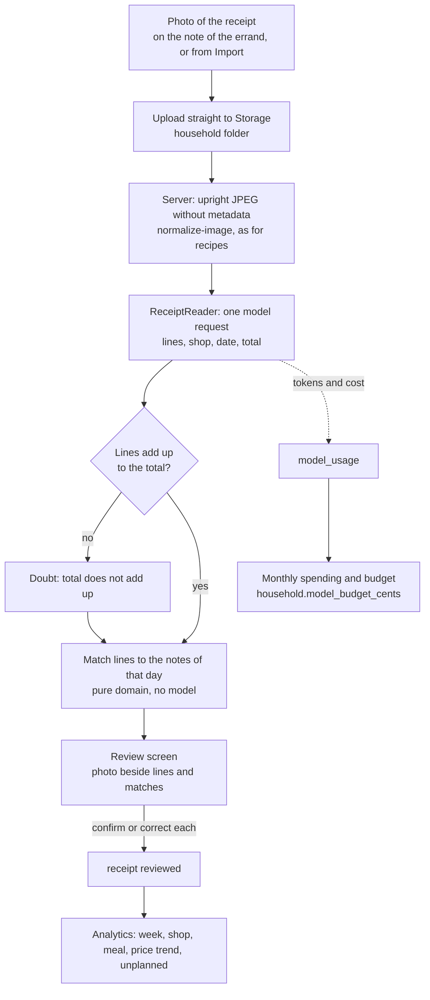

# Shopping

How the shopping list is built from the week plan, which note buys what, how a note is worked
through in the shop, and how it is exported. Also the acceptance test for the list and the
specification of the receipt upload (not built yet).

## Lines and amounts

- Lines are built per canonical ingredient: scale, convert to the ingredient's default unit,
  sum, then round for purchase.
- Every line shows the amount needed in the ingredient's own unit, whatever its buying mode
  (`purchaseFor`): "200 g Crème fraîche", "400 g Champignons", "1 Bund Petersilie", pieces as
  "1x Schalotte", as on the dm note. `count` and `weight` round to the catalog's step,
  everything else to whole pieces or just enough to read well (`naturalStep`: 137,5 g is
  140 g). The household found "Champignons" one week and "4x Champignons" the next, and had
  to open "Crème fraîche" to learn it was 200 g. What comes in packs says how many packs
  with the exact amount, on tap (`packsFor`). A tin is "1x Dose Mais": a name that says its
  unit ("Mais (Dose)") does not say it again. Only a line without any amount ("Petersilie")
  and a pantry staple asked for by the spoonful only ("Salz", "Öl") show the name alone;
  six tablespoons of Schmand are "90 g Schmand" (October 2026).
- Line text: quantity, name, note ("600 g Leberkäse", "Milch WS 1.29"). The exact sum and
  the meals it comes from stay available per line. A note picked up is one column on screen,
  the width of the page, so that an opened line has room: what it is for on the left, amount
  and note on the right, its buttons in one row below. On paper it keeps its columns.
- The amount of a line can be changed on its note ("Menge ändern", `LineState.amount`,
  `shopping_line_state.quantity` and `unit`). The line then says what the plan has, and
  "Wie geplant" takes the change back. The change stays when the plan changes.
- A line does not say on which other notes of the week the same thing stands. "Auch auf:
  Di 27. Supermarkt" with "Dort mitkaufen" under the lines was taken out: the household did
  not need it (October 2026). The arrow of a line moves it.
- The household's word is shown, not the recipe's (Karotten for Möhren). Synonyms map to one
  catalog ingredient. One piece takes the singular when the catalog lists it among the other
  names: "1 Zitrone".
- For an ingredient bought in packs, a typed "2x" or a bare "2" means two packs. Only typed:
  in a recipe a number counts pieces, and "4 Riesengarnelen" are four prawns, a line of
  their own beside any grams other recipes need, not four packs of 225 g. A prawn's weight
  varies too much to guess one from a count.
- When the plan changes, lines are recomputed and matched by a stable line key
  (`<ingredient>@<trip>`), which is unique on one note. Notes, shop overrides, at-home marks
  and check-offs belong to the note and the key and survive. A meal moved to another
  shopping day is a new line there: a tick on Monday's note does not say it was bought for
  Friday. A change is reported only when the quantity shown changes.
- The notes are worked out from the plan every time they are shown (`loadShoppingNotes`), so
  they cannot disagree with the plan. Stored are only what the household does by hand, per
  note (`shopping_list` has one row per household, date and place): typed entries
  (`shopping_manual_entry`) and, per line key, tick, note, "we have that" and the note it
  was moved to (`shopping_line_state`). The table `shopping_line` is not written yet. Lists
  made before there were several shopping days keep their week (`week_plan_id`); new ones
  have none.

## Shops, sections and presentation

- Shop is a household setting per ingredient and can be overridden per line for one week.
  The list by shop (`presentList`: by shop, then by aisle group, a shop can override the
  aisle order) is what the acceptance test compares with the handwritten list.
- The household does not plan by supermarket for now. What it sees, prints and exports is
  each day's list by kind of grocery (`presentByAisle`): one walk through a shop, Obst &
  Gemüse to Sonstiges. A line shows its shop only where one was named on purpose (`shopByChoice`):
  "Brot · Bäcker" for a cold supper.
- The shops offered for a line (`suggestShops`, `shop-choice.ts`): where it was bought
  before first (`shop_item_history`), then those that sell its kind of grocery; the rest
  behind "Alle Geschäfte". The butcher, bakery and market sell what is bought fresh there
  (`fresh_place`), a supermarket found on the map everything, a shop typed in by hand the
  kinds ticked for it under "Angaben", or everything while none is. The Bäcker and the
  Metzger are not offered at all for what they do not sell, not even behind "Alle
  Geschäfte" (`placeSells`), unless the thing was bought there before: a lemon is not
  bought at the Bäcker (October 2026). The market sells anything. Trauben never offer the
  Bäcker; Brezeln offer the Bäcker and the supermarkets, not the Metzger. Eggs stand under
  Dilgers Hof because "Eier" is ticked for it.

## Supermarkets and the map

- The household's supermarkets are found by its postal code (`household.postal_code`,
  `place_name`; empty for a new household, and until it is entered no market can be
  chosen). The server looks the code up on OpenStreetMap (Nominatim), asks Overpass for the
  supermarkets inside its area and offers all of them, each name once (two shops of one name
  are one chain), with the chain's logo from Wikidata and Wikimedia Commons. Showing only
  the nearest five left out Aldi and Lidl in Laupheim. Chosen ones stand first, then the
  chains and the rest by name (`src/server/supermarket-search.ts`,
  `pickSupermarkets`). They are kept as shops (`shop.found_near`, `logo_url`, `address`).
  None of it is hard-coded: the household's own is 88471 Laupheim, entered in the app.
- The card shows five: the chosen ones, then the biggest chains (`offeredSupermarkets`);
  the others are under "Weitere anzeigen". All found stand on a map (`SupermarketMap`):
  Leaflet over the tiles of OpenStreetMap (`LiveMap`, loaded in the browser only), tinted
  towards the app's paper (`.map-tiles`), each market a logo tile (`.map-mark`), the
  household's ringed in green and the main one with a star. It moves and zooms with + and
  −, "Alle" and the fingers; the mouse wheel only after a click into it. A tap on a market
  shows it in a card on the map, to choose it, put it away or make it the main one.
  Underneath lies the same map as plain pictures (`minimap`), shown until the script has
  loaded and without one. Leaflet's stylesheet sets marker pictures to `width: auto`, so a
  mark's logo has its size inline, as everywhere else.
- A market's place comes from the search (`shop.lat`, `lon`), or from its
  street (Nominatim, one request a second): when the household types one ("Angaben"), and
  for every market with a street but no place after each search, also a failed one. From
  Vercel the main Overpass server often cannot be reached; four are tried. The street in
  "Angaben" offers addresses while it is typed (`AddressField`, `/api/adresse`): from Photon
  (photon.komoot.io), because Nominatim's rules forbid search as you type, near the
  household's markets and its postal code first (`readAddressSuggestions`). A picked one
  sends its place along and needs no lookup; one typed by hand is looked up as before.
- "Angaben" also takes the kinds of grocery bought there (`shop.aisle_group_ids`,
  `kindsText`): shown on its tile, and on a supermarket note a line of such a kind stands
  in that market's section (`supermarketForKind`: the first of the household's
  supermarkets that names the kind, the main one first, else the main one). The household
  expected Tiefkühl ticked at Aldi to put frozen food under Aldi (October 2026). It decides
  only between supermarkets: what goes to the market, the butcher or the bakery stays on
  their notes.
- The tiles' grid has `grid-cols-1` on a phone: an untruncated address made
  its column, and with it the page, wider than the screen, which then zoomed out. While
  the search runs, which can take up to a minute, the card says so (`SearchPending`). A tap
  on a market makes it one of the household's or no longer one, the first one chosen being
  the main market; the star next to a chosen one makes it the main one
  (`shop.supermarket_rank`, 1 the main one; `favouriteSupermarkets`). A market the map does
  not know can be typed in.
- A supermarket note buys everything at the main one,
  except the kinds of grocery bought at another one (above). A line can be bought at
  another one for the week ("Kaufe ich bei: Rewe", `shopping_line_state.shop_id`, the main
  one stored by name too, so that it wins over the kind): that supermarket then has a
  section of its own on the note, on paper and in the PDF (`sectionsByShop`). One without such a line has none. Where
  the catalog buys a thing (`preferredShopId`) does not decide the section.
- The logos stand
  wherever a supermarket is named (`ShopLogo`, the name's first letter without one): the
  supermarket note is named after the markets it is taken to, the main one first, and shows
  their logos in place of the cart: "Aldi & Rewe", "Aldi, Rewe & Botzenhardt"
  (`marketsOfNote`, `namesText`), its PDF too; each further one has its logo at its
  section. A line goes to another supermarket with the arrow. A logo's size is set in pixels on the element, never by a class: with a size class
  the stylesheet lacked, the 128-pixel picture filled half the note.

## Shopping days and places

- A household says on which weekdays it goes to the supermarket and to the market
  (`household.shopping_days`, read with `readShoppingDays`, set on `/einstellungen` and asked
  on the first visit). Until it has, the app's own hold (`DEFAULT_SHOPPING_DAYS`: supermarket
  on Monday and Friday, market on Saturday). At least one day must be at a supermarket, where
  everything else is bought. `household.shopping_weekday` is no longer read.
- The butcher and the bakery are gone to only for a meal that needs something from there
  (`ON_DEMAND_PLACES`): their notes have no standing days. The butcher has preferred days,
  a row "Metzger" among the shopping days (stored in `shopping_days` as the place
  `butcher`, which older versions read and ignore). Its meat goes to the last butcher day on
  or before its meal, at most three days before and not before it was planned
  (`butcherDay`, `BUTCHER_REACH_DAYS`): Monday buys for Monday to Thursday, Saturday for the
  weekend and the start of the week. The catalog's shelf life of fresh meat is not asked.
  While no butcher day is ticked, the butcher days are those of the supermarket and the
  market (`butcherWeekdays`). The household found a note for the butcher on every day with
  meat a waste of time (October 2026). Where no butcher day reaches a meal, and for the
  bakery always, it is the day of the meal, and the Saturday for a Sunday (`onDemandDay`).
- The drugstore (dm, place `drugstore`) has one weekday, Saturday until the household picks
  another on `/einstellungen` (`household.drugstore_weekday`, merged into the shopping days
  by `withDrugstore`). It is kept apart from `shopping_days`, which older versions read
  strictly. Its note lies among the others every week, empty until someone writes on it.

## Errands and which note buys what

- Every errand has a note of its own: a place on a day (`ShoppingTrip`, as an address
  `<date>.<place>`). A need goes to the first supermarket errand of its meal's week that is
  in time and from which it keeps until the meal (`assignTrip`): Monday buys the leeks,
  lemons and fish stock for Friday's dinner, and Friday only what would not keep from
  Monday, so that the week needs as few big errands as it can. The family asked for it
  (October 2026). Where no errand of the week can, it is the last shopping day before the
  meal, as before; a week's errand never buys for the week after. It holds from the week of
  26 October 2026 (`FIRST_ERRAND_FROM`, `ErrandRules.firstErrandFrom`): the week before was
  shopped by the old rule, its Monday is done, and what it left is on Friday's note.
- The household shops in the afternoon from Monday to Friday and in the morning on Saturday
  (`AFTERNOON_WEEKDAYS`), so a lunch on a working day is bought on an errand before its day
  (`Need.lunch`): Friday's lunch on Monday's note, Monday's on the Friday before, and its
  meat on a butcher day before it where one reaches it. What would not keep that long is
  bought shortly before ("later"), as from any errand. Only where no earlier errand could
  buy it (planned after it, or no butcher day in reach) does the meal's own day stay. The
  household asked for it: it never shops on a Friday morning (October 2026).
- An errand does not buy for what was planned after it. A week planned on Sunday gets
  nothing from Saturday's market; its vegetables for Monday are on Monday's note.
- What would not keep from its shopping day, and what was planned after the last shopping
  day before its meal, is bought shortly before (`trip` "later"). It is no section of its
  own: the line stands with its kind of grocery. Only what goes bad knows for which day it
  is bought ("für Do. 15. Oktober", `neededBy`): tomatoes and yoghurt, not flour. The day is
  shown when the line is opened with a tap, not on the line, and not on paper or in the PDF:
  the household found a date on every line too much.
- A note is the same real errand from whichever week it is looked at: Saturday's market note
  holds what the weekend needs and what Monday and Tuesday of the next week need, summed.
  The page of a week shows the errands in it, and one before it when that buys for the
  week. `loadShoppingNotes` therefore reads the plans of the weeks around it.

### Market, butcher and bakery

- What a kind of grocery says is bought fresh elsewhere (`aisle_group.fresh_place`: fruit,
  vegetables and fish at the market, meat at the butcher; the household's to change on
  `/einstellungen`) goes on that place's note. For the market that is when its day is at
  most three days before the meal and it keeps until then: the weekend and the start of the
  week, also though Monday is a supermarket day. Meat is a note for the butcher on its butcher
  day (see the butcher rules in [Shopping days and places](#shopping-days-and-places)). A kind of grocery can also come from the bakery (`fresh_place` "bakery",
  e.g. "Brot & Backwaren", the default since October 2026): it is then a note for the bakery
  on the day of its meal, for a Sunday on the Saturday, like bread named for a cold supper.
  What of such a kind keeps longer than five days or has no shelf life is packed (toast,
  wraps, crispbread) and stays at the supermarket (`BAKERY_FRESH_DAYS`). A household that buys everything in one go, like the one of the handwritten
  list, says so with `onDemand: []`.
- A shop named on purpose is gone to in any case (`shop.kind`, `Need.at`): the butcher on
  its butcher day like meat for cooking, the bakery on the day of the meal, the market on
  its day when that reaches the meal and otherwise on the day of the meal too, which then
  has an errand of its own. Bread and cold cuts for a "Vesper" on Monday are a note for the
  bakery and one for the butcher on Monday, next to the supermarket's. So a week shows the household's shopping days and every other day
  something is bought on.

## Moving an errand to another day

- An errand can be done on another day ("An einem anderen Tag einkaufen" on its note,
  `changeNoteDay`). The note offers the three days before and after and says for each
  whether it works, and if not, why (`dayProblems`): something on it is needed before that
  day, or would not keep from that day until its meal, or the day is over. A lunch on a
  working day is needed before that day's errands ("am Mittwochmittag"), as the notes are
  worked out. On a butcher note a visit's reach (`BUTCHER_REACH_DAYS`) stands for the
  shelf life: the meat is kept cold for those days on purpose. A line that belongs to no
  meal, and one that is bought shortly before its meal anyway, is no obstacle. The
  household asked to be told why, not just to be stopped. Changing the day moves the
  errand itself (`shopping_list.moved_to`, `moveErrand`): the week is worked out with it on
  the new day (`withMovedErrands`), so what the plan adds later goes there, what keeps from
  there is bought there, and the note of its own day is gone. A moved errand reaches the
  meals it buys fresh for from its own day (`ShoppingTrip.reachFrom`): the market moved from
  Saturday to Friday still buys Tuesday's carrots. The decisions on its lines
  and what was typed onto it go along. Moving only the lines left the errand on Monday for
  the rules: milk for Sunday would not keep from Monday and got an errand of its own on
  Friday, though the family shopped on Tuesday (October 2026). Its lines are moved as well,
  for a note that is no standing errand (the bakery on a meal's day). Any note can be done on its own day by these rules: whole weeks on
  the real errands are held against it (`tests/acceptance/sample-weeks.test.ts`).
- "An einem anderen Tag einkaufen" does a whole errand on another day, earlier or later:
  from today, or six days before it, to three days after it (`noteDays`). A day is ruled
  out only when it is over or something on the note is needed before it (`blocks`); that
  something would not keep so long is said beside the day and stops nothing: the catalog's
  shelf lives are estimates. A decision the server
  refuses says so at the foot ("nicht gespeichert"), and another shop on the same note keeps
  the line on it while it is stored (`leavesNote`), not "→ Di".

## When an errand is done, and the order of the notes

- An errand is done when no line of its note is open and something on it was bought: each
  line is bought, in full or in part, or removed, by the last decision, or by "Einkauf
  erledigt", which ticks what is still open. Its moment is the last purchase, never a line
  removed: a removal is a decision about the plan, and two lines taken off Monday's note
  while the week was planned made the errand done, so everything planned afterwards was
  bought "shortly before" on a note under "Erledigt", where nobody looked for the olives
  (October 2026). A note whose lines were only removed was not shopped. A done note pales,
  moves to the foot of the page under "Erledigt" (`arrangeNotes`), and carries a stamp with
  the name of whoever made the last tick (`NoteList.completed`, from
  `shopping_line_state.checked_by` and the member's `display_name`). Nothing is stored for
  it (`completion`): a line the plan adds afterwards opens the errand again, which is what
  it is, and so does a line typed onto the note. What was planned after the last tick does
  not: that errand has not bought it. The notes are worked out a second time with the
  errands that are done (`ErrandRules.doneAt`), and such a need goes to the next errand in
  time or is bought shortly before.
- The notes still to do lie first, from today on in order of day and place, then one whose
  day is over with something still open. A note whose day is over and that has nothing on
  it is not shown: Monday's empty dm note said nothing on a Tuesday (October 2026). Nor is
  an empty note while another one of the week has something on it, unless it is there to be
  written on: the drugstore's, or one opened by hand.

## Moving lines between notes

- A line moved to another note (the arrow, above) is offered only shops that sell it
  (`placeSells`: no lemon at the Bäcker). The move is stored with the note the line would be on by itself
  (`shopping_line_state.moved_date`, `moved_place`) and applied before the lines are summed,
  so a moved line adds up with what its new note needs anyway. Every part of a line knows
  the note it came from (`Contribution.origin`, `originsOf`). The lines of one thing split
  by an amount that cannot be merged ("ingwer@main#Stück") move together (`partKey`).
- The arrow moves a line to any day from today, up to a week before its note and a week
  after it (`moveDays`, `canMoveTo`): bought earlier (the salad for Sunday on Wednesday,
  toilet paper on the main errand) or later, also where the plan needs it earlier: the
  decision is the household's. The form says what would come too late or not keep
  (`lineWindow`, `windowProblems`), and stops nothing. It starts on the note's own day, or
  on today where that is over (`moveStartDay`): started on a day that was over, the server
  refused the move and the Wiener stayed at the butcher. The arrow is the one way to move a
  line, and the shelf the one way to say it is at home: "Lieber woanders kaufen" and "Bei
  EDEKA kaufen" in the opened line said the same once more (October 2026). An opened line
  says what it is for, then Menge, Notiz and Gehört zu, each with its name above.
- A line typed onto a note stays on that note, unless it is moved.

## At home ("Haben wir schon")

- What is needed and at home is one list for the whole week, under the notes ("Haben wir
  schon"), not one per note: each thing once, by kind of grocery, without the note it would
  be on (`groupAtHome`). "Doch kaufen" puts every line it stands for back on its note while
  that errand is still to come, otherwise on the next note from today on that sells it and
  is in time for its meal, and where none is, on a supermarket note today (`noteToBuyOn`).
  It is not at home there either. The server chooses the note.
- "Haben wir schon?": pantry staples are pre-ticked as at home. A line the user added by hand
  is never pre-ticked. The staples are the household's to change: a tile in the settings
  opens `/einstellungen/vorrat` (`ingredient.is_pantry_staple`), the staples by kind of
  grocery (`pantryByAisle`), with a search that follows while typing through the whole
  catalog (`searchCatalog`), to take each out or put it in with one tap. The household found
  the 180 staples as chips on the settings page unstructured.

## Free entries

- Free entries are first-class. "Milch WS 1.29" is matched to the catalog (Milch) and keeps
  the rest as a note. Where the ingredient is named after what describes it ("grüne
  Trauben"), the longest run of words anywhere that names one wins, in the singular or the
  plural too, and the other words are the note: the grapes are fruit (`parseFreeEntry`).
  Text that matches nothing stays a free line under "Sonstiges", until the household puts
  it under a kind of grocery on the opened line ("Gehört zu", `kindOfEntry`,
  `shopping_manual_entry.aisle_group_id`). Every entry of the same text goes with it, and
  the same text written again later takes that kind by itself (`rememberedKind`).
- A typed line the catalog does not know gets its kind of grocery guessed once as it is
  written, from the end of its last word (`guessKind`: "Bio-Heumilch" is dairy,
  "Ingwer-Shots" stay unsorted), and "Gehört zu" corrects it.

## Extras and foods of meals without a recipe

- Besides the cooked meals the lists hold the week's extras, scaled like a meal and bought for
  their day like a meal, or without a day on the week's first supermarket day, and the foods
  of meals without a recipe, by name and without an amount. The exception is a food named as one piece of something bought by the piece:
  "Gurke" for the catalog's "Gurken" is "1 Gurke" and adds up with what recipes need
  (`namesOnePiece`). Named in the plural it stays a name. A food bought somewhere else than the catalog says is its own line
  (`<ingredient>@<trip>@<shop>`). What someone asked for by name is never assumed to be at home.

## The drugstore (dm) and notes opened by hand

- The drugstore's note is written by hand only, never from the plan: what, how many and,
  if it is for someone in particular, for whom (`shopping_manual_entry.quantity`,
  `for_whom`; "2x Duschgel für Lena", one of something is just its name). Typing suggests typical drugstore items
  (`DRUGSTORE_ITEMS`), "Für wen" the names of the household's members. Each line is sorted
  into a section of the shop, Körperpflege to Haushalt (`drugstoreSection`: the longest
  known word in what was written wins, anything else is "Sonstiges"). Its lines are not
  moved to a food note, have no "Haben wir schon", and the note is not moved to another day.
- Any note can be opened by hand for a place on a day of the week from today on ("Neuer
  Zettel" under the notes, `daysToOpen`, `openNote`): dm on a Wednesday, the bakery on a
  Thursday. It is stored as its list with `shopping_list.opened_at` and lies among the notes
  of its week while it is empty; "Leeren Zettel wegwerfen" puts it away again. It is no
  errand the plan is bought on: what is planned goes where it always goes, and a line can
  be moved there.
  What is still open on a dm note whose day is over comes along to the next one from today
  on (`carriedOver`, `nextDrugstoreTrip`, eight weeks back at most), until it is ticked or
  removed, and stands only there (`bringAlong`), also where the note it came from lies in
  the same week. A tick on the note it came along to is stored there; an entry ticked on
  any earlier note stays behind.

## The Merkzettel

- The Merkzettel (`restock_item`, in the header of every page with the number of its
  entries) holds what ran out at home. It is not a shopping note: "Auf den Einkaufszettel"
  moves an entry to the note of the next errand from today on that sells it (`restockTrip`,
  with the errands done on another day where they happen),
  where it is a typed line, and takes it off. Flour noted on a Saturday waits for Monday;
  carrots are bought at the market that day; bread goes on the bakery's note that day, on
  a Sunday Monday's (the bakery has no day to wait for), packed bread to the supermarket. What the drugstore sells (`isDrugstoreItem`,
  "Zahnpasta", also "Spülmittel" that the food catalog knows) goes to the next dm note, a
  number in front, in digits or words, as its quantity (`drugstoreEntryFromText`: "2
  Duschgel", "zwei Zahnpasta"), and is sorted
  into its section there. Where an entry is bought fresh is looked up in
  the catalog once, when it is written (`restock_item.fresh_place`, and its kind of grocery
  in `restock_item.aisle_group_id`), so that the header of every page can say where each
  entry goes without reading the catalog: at a supermarket errand the supermarket its kind
  is bought at ("TK-Beeren · Mo 19. Aldi", `restockSupermarket`). Entries written before
  the kind was kept name the main one. While it has
  entries, the Merkzettel also lies among the shopping notes.

## Ticks and decisions

- A tick is one kind of decision about a line (`Decision`,
  `src/domain/shopping-list/decisions.ts`): bought (maybe another product or amount),
  bought in part with the rest discarded or moved, removed, moved, or open again. Every
  decision goes the way ticks go (the next bullet), and on the server through `decide_shopping_line`
  (one clock per line, `checked_changed_at`, shared with `tick_shopping_line`), so all of
  them work offline and two people never undo each other. `applyDecisions` does what
  follows: a move records the note it was made on (`moved_with`) so that taking it back
  finds every part, a rest becomes an entry on its note (`carried_from_*`), and each
  purchase is counted in `shop_item_history`.
- A tick is "this line is ticked (or open) since then", not "toggle" (`Tick`,
  `src/domain/shopping-list/ticks.ts`). It is kept in IndexedDB first (`TickQueue`,
  `src/lib/tick-sync.ts`, `src/lib/tick-store.ts`) and sent to `/api/einkauf/haken` at once,
  when the connection comes back, when the app is opened again, and every 15 seconds while
  something waits. The server stores it with `tick_shopping_line`: per line the tick made
  last wins, by `shopping_line_state.checked_changed_at`; a tick sent twice changes nothing,
  and a time in the future counts as now. Two people ticking never undo each other. The
  device shows its own tick over a page drawn before the server took it
  (`shownChecked`, `WeekNotes.readAt`). Every tick on a note, also "Einkauf erledigt", goes
  this way; the plain form is the fallback without scripts.

The service worker, kept pages and forms without a connection: see [ARCHITECTURE.md](ARCHITECTURE.md#offline).

## Line actions and swipes

- Every row of a note and of the view for the shop has its actions at its end, quiet and
  without words (`ActionRow`, `src/components/line-actions.tsx`): the arrow moves it, the
  pen says what was bought (a stepper "3 von 6", another product), the bin removes it
  without asking. A swipe to the right buys, to the left removes; a finger held still
  opens the same as a menu. On a note, planned and looked over before the shop, the shelf
  takes the bin's place ("Haben wir schon", `ShelfIcon`, the `markAtHome` form, so it works
  before any script): a swipe to the left and the menu say the same, on a calm grey instead
  of the warning red. Only a line written by hand can still be removed there, from the
  menu, for a slip of the pen; the drugstore's note, which has no "Haben wir schon", keeps
  the bin. The household found the bin there meant "not bought", which is decided in the
  shop (October 2026). Each decision can be taken back for five seconds from the bar
  at the foot ("Widerrufen"). The bar rises when it first appears and then stays, the next
  decision only changing its words (a transition, not keyframes): shown afresh for each, it
  jumped under quick swipes. A line removed folds away (`data-gone`: its height closes and
  it fades in 160ms) instead of making the lines below it jump. The view for the shop has its own menu, sheets and bar
  (`LineActionsHere`): a modal dialog makes everything outside it inert. On a note the
  actions stand at the end of the line's first row, and an opened line runs the width of
  the note under them; beside them it was a narrow column on a phone.

## Not bought

- Nothing is deleted from a note. A removed line, typed or planned, keeps its row
  (`shopping_line_state.status`, `removed_reason`), and what the plan had stays beside what
  was bought (`planned`, `bought_name`, `bought_quantity`, `bought_unit`, `substituted`).
  Removed lines and discarded rests are the note's "Nicht gekaufte Einträge"
  (`notBoughtOf`), with "Wieder aufnehmen". What was moved is not among them: it is still
  to buy, and its own note says where it went ("Eier → Di", `movedAway`). A finished note
  lies green among the others and says how much was not bought. A removed dm entry does
  not come along to the next dm note.

## The view for the shop

- "Jetzt einkaufen" on a note opens the view for the shop (`StoreView`, a `<dialog>` over
  the whole screen; `#laden` opens it too): the note's lines by supermarket and kind of
  grocery, each row one large button to tick, how many are ticked of how many, whether
  ticks wait for a connection ("Offline – 3 Häkchen warten", `SyncStatus`), and "Einkauf
  erledigt". The screen stays on while it is open (Wake Lock, where the browser has it).

## Export and PDF

- Export: the page has a print layout (black on white, a box per line, no controls, on the
  paper of the PDF: `printRules` sets page size, columns and size of the writing from
  `NOTE_PAPER`) for the note that is picked up, and `/einkauf/pdf` writes notes with `pdf-lib`:
  each note as a file of its own, or all of them in one file, every note on its own page.
  Both show what is still to buy, without what is ticked off or at home. The PDF is a small
  notepad sheet to take along instead of a phone: A6, one column, black on white, faint
  ruled lines, no binding holes. The size is one constant for both (`NOTE_PAPER`
  in `src/lib/note-paper.ts`, with A6, A5 and A4 laid out). A note taken to several
  supermarkets has a section per supermarket in the PDF too, its name once above its kinds
  of grocery (`pdfSections`), not in front of every heading.

## Acceptance test

The fixtures (`tests/fixtures/sample-week/`) and the test itself: see [ARCHITECTURE.md](ARCHITECTURE.md#tests).

The generated list is accepted when, per shop, it has the same lines as the handwritten one,
buying the same quantity where the paper shows one (as many packs of what comes in packs:
"2x Garnelen" is 450 g), the same note, and an aisle order the handwritten order does not
contradict. Where the paper shows no quantity, the line may show the amount the recipes
need: the household asked for it in front of every line (October 2026). The handwritten week had one
shopping day, so the test builds its list for Monday alone (`singleTrip`).

Lines that come from a recipe the household has not added yet are listed under `pendingLines`
in `inputs.json`. When such a recipe is added to `supabase/seed/recipes.ts`, give the plan slot
its `sampleRecipe`, remove the lines from `pendingLines`, and the test must still pass.

## Receipts (specified, not built yet)

Status: specified, data model migrated (`supabase/migrations/20261019000800_receipts.sql`),
nothing written to it yet.

### Goal

A photo of a receipt after an errand. From it the app learns what was actually bought and
paid, without anyone typing it:

- the receipt's lines (product, quantity, price), its shop and its date, read by a model;
- each line matched against the shopping note of that errand, suggested by the app and
  confirmed or corrected by the household (the model suggests, it never decides);
- what the week cost, per shop, per meal, how the price of one thing moves, and how much
  was bought that was not on any note;
- every receipt counted in the household's model spending, next to recipe imports.

Phase 1 already records the shop side of an errand (bought, bought in part, removed, moved,
substituted, in `shopping_line_state`). The receipt adds the money side and checks the shop
side against what was paid.

### Flow

1. **Upload.** On a note that is done ("Kassenbon hinzufügen") or under Import. As for
   recipe photos: the browser uploads to Storage, the server makes an upright JPEG without
   metadata, and the upload from the phone is deleted.
2. **Read.** One request through a new `ReceiptReader` type
   (`src/server/import/read-receipt.ts`), with the model from `ANTHROPIC_RECEIPT_MODEL`.
   Structured output: shop name as printed, date and time, total, and per line the text
   as printed, quantity, unit, unit price, price and kind (product, deposit, discount).
   Never guess: an unreadable value is null and named in `uncertain`, as for recipes.
3. **Check.** Pure domain code (`src/domain/receipts/`): the lines add up to the total,
   deposits and discounts are counted, and a quantity line ("2 x 0,89") belongs to the line
   above it. A mismatch is a doubt and sends the receipt to review. No second model pass at
   first: the total is a free check that a recipe does not have.
4. **Match the shop and the errand.** The shop name is matched to the household's shops
   (normalised name, chain word). The date picks the notes of that day; of several, the
   note of that shop's place.
5. **Match the lines.** For each receipt line, a score against each line of the note:
   normalised name overlap with the catalog name and synonyms, the line's own word
   (`bought_name` for a substitute), the quantity read, and the line's kind of grocery. The
   best score above a threshold becomes a suggested `receipt_match`. Unique assignment: one
   note line takes at most one receipt line, best scores first. Receipt abbreviations
   ("BIO VOLLM 1,5%") are matched by the catalog's synonyms. What the household confirms
   for a printed text is remembered for that shop, so the next receipt matches it by itself.
6. **Review.** Photo beside the lines, each line with its suggested note line and "Stimmt",
   "Anderes" (pick a line of the note) or "Nicht auf dem Zettel" (unplanned). Everything
   is confirmed with one button, as "Neue Zutaten" is.
7. **Feed back into the note (optional, see open questions).** A confirmed match whose
   quantity differs from what was ticked updates `bought_quantity`. A note line with no
   receipt line that is ticked as bought is reported, not changed.

### Data model

All tables have `household_id`, row level security and a policy; `isolation.test.ts`
holds a row of each.

| Table                          | What it holds                                                                                                                                      |
| ------------------------------ | -------------------------------------------------------------------------------------------------------------------------------------------------- |
| `receipt`                      | One photo: paths (in the household's folder), shop as read and matched, time of purchase, the note it belongs to, total, status, doubts, reviewer. |
| `receipt_line`                 | One printed line: text as read and as corrected, quantity, unit, unit and line price in cents, kind, catalog ingredient.                           |
| `receipt_match`                | A receipt line matched to a note line (`shopping_list_id`, `line_key`): score, suggested, confirmed or rejected, by whom. One confirmed per line.  |
| `model_usage`                  | Every model request: purpose, model, tokens, cost in millionths of a cent, the receipt or import batch it was for. Written by the server only.     |
| `household.model_budget_cents` | What the household may spend on models in a month. Null: no limit.                                                                                 |

Planned and actual stay apart:

- **Planned:** what the plan asked for. Computed from the plan, and kept as `shopping_line_state.planned` from the first deviation on.
- **Bought:** what the household recorded in the shop (`status`, `bought_*`).
- **Paid:** what the receipt says (`receipt_line`).

Money is integer cents throughout, and a receipt's currency is stored on it.

### Analytics

All of them are pure functions over the rows above. A page under "Einkauf", and the week's
total on the week plan's "Alle Wochen".

- **Spend per week or plan:** the sum of `receipt.total_cents` by the week of
  `purchased_at`. The week of a note that buys for two weeks (Saturday's market) counts
  for the week it lies in.
- **Spend per shop:** the same, by `receipt.shop_id`.
- **Cost per meal:** for each confirmed match, the receipt line's price is shared among the
  meals behind the note line (`Contribution`), in proportion to the amount each asks for.
  A pantry staple bought for several weeks is shared only over its contributions, which
  makes such meals look cheap. That is stated, not hidden.
- **Price trend per item:** the unit price over time per `ingredient_id`, unit prices made
  comparable through the catalog's units (price per kg, per l, per piece).
- **Unplanned share:** receipt lines without a confirmed match, of all product lines, by
  count and by money. A line typed onto a note counts as planned: it was on the list.

### Quota and cost

- Every model request writes a `model_usage` row: receipts from the start, and recipe
  imports too once the readers record it. The readers already return token usage
  (`anthropic-reader.ts`), but nobody stores it yet.
- The cost of a request is computed on the server from the model's price table: one
  constant per model in `src/server/model-prices.ts`, checked against the API's pricing
  when a model changes.
- Before a request, the server sums the month's `cost_microcents`. Past
  `model_budget_cents` the request is refused with a message that says so. It is never
  handed to a cheaper or pricier model by itself.
- Expected cost: a receipt is about one image and 300 to 800 output tokens. On
  `claude-haiku-5-5` that should be well under 0.5 cents per receipt. It is measured with a
  `npm run import:eval-receipts` on a few of the household's own receipts before it is
  turned on, as recipes were.

### Open questions

1. **Receipts kept or not.** A receipt shows where and when the family shops. Keep the
   photo like recipe photos, or delete it once reviewed and keep only the lines?
2. **Feeding back.** Should a confirmed receipt correct what was recorded in the shop
   (`bought_quantity`), or only point out the difference?
3. **Budget.** A household budget for all model use, or a separate count of receipts per
   month? Who sets it: the admin only?
4. **Several receipts for one errand,** for example one at Aldi and one at Dilgers Hof on the
   same supermarket note: allowed, each matched only against its shop's section?
5. **Deposits (Pfand).** Count them in the week's spend, or net them against the bottles
   returned?
6. **Unplanned but expected.** Coffee, toilet paper and the like are rarely on a note. Should
   the household be able to mark a product as "always unplanned" so it does not inflate
   the unplanned share?
7. **Other families.** The open item on who pays for models applies here too: the ledger is
   per household, the API key is shared.

### Effort estimate

Sized from phase 1, which took about one working day with tests.

| Part                                                                   | Effort          |
| ---------------------------------------------------------------------- | --------------- |
| Upload and normalise (reusing the recipe path)                         | 0.5 day         |
| `ReceiptReader`, prompt, eval script on own receipts                   | 1 day           |
| Domain: totals check, shop and line matching, with tests               | 1 to 1.5 days   |
| Review screen (photo beside lines, confirm all)                        | 1 day           |
| `model_usage` for receipts and recipe imports, budget check            | 0.5 day         |
| Analytics domain and a first page (week, shop, unplanned, price trend) | 1 to 1.5 days   |
| Cost per meal                                                          | 0.5 day         |
| Browser tests in the test household                                    | 0.5 day         |
| **Total**                                                              | **6 to 7 days** |

The riskiest part is matching receipt abbreviations to the catalog. It should be measured
on ten of the household's real receipts before the review screen is built.
