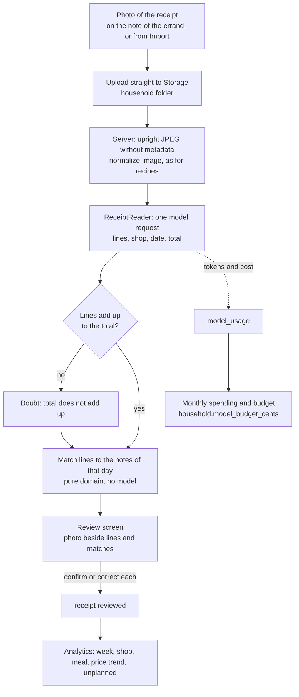

# Receipt upload (phase 2 spec)

Status: specified, data model migrated (`supabase/migrations/20261019000800_receipts.sql`),
nothing written to it yet.

## Goal

A photo of a receipt after an errand. From it the app learns what was actually bought and
paid, without anyone typing it:

- the receipt's lines (product, quantity, price), its shop and its date, read by a model;
- each line matched against the shopping note of that errand, suggested by the app and
  confirmed or corrected by the household (the model suggests, it never decides);
- what the week cost, per shop, per meal, how the price of one thing moves, and how much
  was bought that was not on any note;
- every receipt counted in the household's model spending, next to recipe imports.

Phase 1 already records the shop side of an errand (bought, bought in part, removed, moved,
substituted, in `shopping_line_state`). The receipt adds the money side and checks the shop
side against what was paid.

## Flow

1. **Upload.** On a note that is done ("Kassenbon hinzufügen") or under Import. As for
   recipe photos: the browser uploads to Storage, the server makes an upright JPEG without
   metadata, and the upload from the phone is deleted.
2. **Read.** One request through a new `ReceiptReader` type
   (`src/server/import/read-receipt.ts`), with the model from `ANTHROPIC_RECEIPT_MODEL`.
   Structured output: shop name as printed, date and time, total, and per line the text
   as printed, quantity, unit, unit price, price and kind (product, deposit, discount).
   Never guess: an unreadable value is null and named in `uncertain`, as for recipes.
3. **Check.** Pure domain code (`src/domain/receipts/`): the lines add up to the total,
   deposits and discounts are counted, and a quantity line ("2 x 0,89") belongs to the line
   above it. A mismatch is a doubt and sends the receipt to review. No second model pass at
   first: the total is a free check that a recipe does not have.
4. **Match the shop and the errand.** The shop name is matched to the household's shops
   (normalised name, chain word). The date picks the notes of that day; of several, the
   note of that shop's place.
5. **Match the lines.** For each receipt line, a score against each line of the note:
   normalised name overlap with the catalog name and synonyms, the line's own word
   (`bought_name` for a substitute), the quantity read, and the line's kind of grocery. The
   best score above a threshold becomes a suggested `receipt_match`. Unique assignment: one
   note line takes at most one receipt line, best scores first. Receipt abbreviations
   ("BIO VOLLM 1,5%") are matched by the catalog's synonyms. What the household confirms
   for a printed text is remembered for that shop, so the next receipt matches it by itself.
6. **Review.** Photo beside the lines, each line with its suggested note line and "Stimmt",
   "Anderes" (pick a line of the note) or "Nicht auf dem Zettel" (unplanned). Everything
   is confirmed with one button, as "Neue Zutaten" is.
7. **Feed back into the note (optional, see open questions).** A confirmed match whose
   quantity differs from what was ticked updates `bought_quantity`. A note line with no
   receipt line that is ticked as bought is reported, not changed.

## Data model

All tables have `household_id`, row level security and a policy; `isolation.test.ts`
holds a row of each.

| Table                          | What it holds                                                                                                                                      |
| ------------------------------ | -------------------------------------------------------------------------------------------------------------------------------------------------- |
| `receipt`                      | One photo: paths (in the household's folder), shop as read and matched, time of purchase, the note it belongs to, total, status, doubts, reviewer. |
| `receipt_line`                 | One printed line: text as read and as corrected, quantity, unit, unit and line price in cents, kind, catalog ingredient.                           |
| `receipt_match`                | A receipt line matched to a note line (`shopping_list_id`, `line_key`): score, suggested, confirmed or rejected, by whom. One confirmed per line.  |
| `model_usage`                  | Every model request: purpose, model, tokens, cost in millionths of a cent, the receipt or import batch it was for. Written by the server only.     |
| `household.model_budget_cents` | What the household may spend on models in a month. Null: no limit.                                                                                 |

Planned and actual stay apart:

- **Planned:** what the plan asked for. Computed from the plan, and kept as `shopping_line_state.planned` from the first deviation on.
- **Bought:** what the household recorded in the shop (`status`, `bought_*`).
- **Paid:** what the receipt says (`receipt_line`).

Money is integer cents throughout, and a receipt's currency is stored on it.

## Analytics

All of them are pure functions over the rows above. A page under "Einkauf", and the week's
total on the week plan's "Alle Wochen".

- **Spend per week or plan:** the sum of `receipt.total_cents` by the week of
  `purchased_at`. The week of a note that buys for two weeks (Saturday's market) counts
  for the week it lies in.
- **Spend per shop:** the same, by `receipt.shop_id`.
- **Cost per meal:** for each confirmed match, the receipt line's price is shared among the
  meals behind the note line (`Contribution`), in proportion to the amount each asks for.
  A pantry staple bought for several weeks is shared only over its contributions, which
  makes such meals look cheap. That is stated, not hidden.
- **Price trend per item:** the unit price over time per `ingredient_id`, unit prices made
  comparable through the catalog's units (price per kg, per l, per piece).
- **Unplanned share:** receipt lines without a confirmed match, of all product lines, by
  count and by money. A line typed onto a note counts as planned: it was on the list.

## Quota and cost

- Every model request writes a `model_usage` row: receipts from the start, and recipe
  imports too once the readers record it. The readers already return token usage
  (`anthropic-reader.ts`), but nobody stores it yet.
- The cost of a request is computed on the server from the model's price table: one
  constant per model in `src/server/model-prices.ts`, checked against the API's pricing
  when a model changes.
- Before a request, the server sums the month's `cost_microcents`. Past
  `model_budget_cents` the request is refused with a message that says so. It is never
  handed to a cheaper or pricier model by itself.
- Expected cost: a receipt is about one image and 300 to 800 output tokens. On
  `claude-haiku-5-5` that should be well under 0.5 cents per receipt. It is measured with a
  `npm run import:eval-receipts` on a few of the household's own receipts before it is
  turned on, as recipes were.

## Open questions

1. **Receipts kept or not.** A receipt shows where and when the family shops. Keep the
   photo like recipe photos, or delete it once reviewed and keep only the lines?
2. **Feeding back.** Should a confirmed receipt correct what was recorded in the shop
   (`bought_quantity`), or only point out the difference?
3. **Budget.** A household budget for all model use, or a separate count of receipts per
   month? Who sets it: the admin only?
4. **Several receipts for one errand,** for example one at Aldi and one at Dilgers Hof on the
   same supermarket note: allowed, each matched only against its shop's section?
5. **Deposits (Pfand).** Count them in the week's spend, or net them against the bottles
   returned?
6. **Unplanned but expected.** Coffee, toilet paper and the like are rarely on a note. Should
   the household be able to mark a product as "always unplanned" so it does not inflate
   the unplanned share?
7. **Other families.** The open item on who pays for models applies here too: the ledger is
   per household, the API key is shared.

## Effort estimate

Sized from phase 1, which took about one working day with tests.

| Part                                                                   | Effort          |
| ---------------------------------------------------------------------- | --------------- |
| Upload and normalise (reusing the recipe path)                         | 0.5 day         |
| `ReceiptReader`, prompt, eval script on own receipts                   | 1 day           |
| Domain: totals check, shop and line matching, with tests               | 1 to 1.5 days   |
| Review screen (photo beside lines, confirm all)                        | 1 day           |
| `model_usage` for receipts and recipe imports, budget check            | 0.5 day         |
| Analytics domain and a first page (week, shop, unplanned, price trend) | 1 to 1.5 days   |
| Cost per meal                                                          | 0.5 day         |
| Browser tests in the test household                                    | 0.5 day         |
| **Total**                                                              | **6 to 7 days** |

The riskiest part is matching receipt abbreviations to the catalog. It should be measured
on ten of the household's real receipts before the review screen is built.
